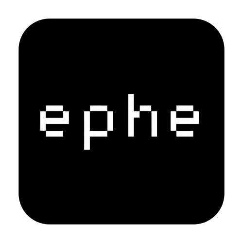

<p align="center"></p>

# ephe

**Temporary text pad between your computer and your phone. Local network only. Nothing saved. Nothing left behind.**

Run `ephe.exe`, scan the QR with your phone, type together. Close the window — everything is gone.

Can't scan the QR? The mobile link is also shown as plain text on the desktop — click **copy link** and send it to the phone.

- **~900 KB single portable binary** — no install, no admin, no runtime
- **Local network only** — no cloud, no relay, no telemetry, no account
- **In-memory only** — text lives in RAM; wiped on any disconnect
- **One binary, one process** — opens your default browser, serves the phone page, runs the WebSocket
- **MIT licensed**

## Quick start

1. Download **`ephe-portable.zip`** from the latest release (just `ephe.exe` + `Logo.png`).
2. Extract anywhere. Double-click `ephe.exe`.
3. Your default browser opens with a QR code.
4. Scan it with your phone (must be on the same Wi-Fi).
5. Type. Both sides see the same text in real time.
6. Close the browser tab, or `Ctrl+C` in the terminal.

That's it.

## Or: install with the NSIS installer

1. Download **`ephe-setup.exe`**.
2. Run it. It installs to `%LOCALAPPDATA%\ephe`, adds a Start menu shortcut, and registers an uninstaller.
3. Same usage.

## Requirements

- Windows 10 / 11 (x64)
- A phone on the same Wi-Fi as your computer
- On first run, Windows Firewall will ask to allow incoming connections — say **Yes** (private networks)

## Environment overrides

| Variable | Effect |
|---|---|
| `EPHE_PORT=8080` | Bind to a specific port instead of the random 40000–50000 |
| `EPHE_IP=192.168.x.x` | Force a specific LAN IP (if auto-detect picks a VPN/tunnel) |
| `EPHE_NO_BROWSER=1` | Run as a server only — no browser opens |

## What it does

- Starts a tiny HTTP + WebSocket server on a random local port
- Detects the Wi-Fi IP, generates a QR code pointing at `http://<lan-ip>:<port>/?token=...`
- Opens your default browser at `http://localhost:<port>/?role=desktop&token=...`
- Phone scans QR → connects → both sides have a shared textarea
- Up to two phones can connect to the same desktop session
- Every keystroke syncs over WebSocket (~16ms debounce)
- Either side disconnects → text wiped, session ends, server shuts down

## What it does not do

- ❌ No persistence — no disk writes, no history, no autosave
- ❌ No network outside your LAN — no cloud, no telemetry, no analytics
- ❌ No third-party API calls — phone + desktop only
- ❌ No rich text, no formatting, no markdown, no images
- ❌ No account, no login, no sign-up
- ✅ Up to **two phones** at a time (one desktop + two mobiles; a third is rejected)
- ❌ No mobile app — phone is just a browser

## Reset during a session

On the desktop, when the session ends (peer left, disconnected), a **"start new session"** button appears. Clicking it rotates the token and refreshes the QR. The phone has to re-scan — old URL is invalidated.

## Architecture

```
ephe.exe
├── src/main.rs    entry, picks port + IP, opens browser, runs until Ctrl+C
├── src/lib.rs     library root, test helpers
├── src/net.rs     LAN IP detection (skips VPN/tunnel interfaces, picks Wi-Fi)
├── src/server.rs  axum HTTP + WebSocket handler
├── src/session.rs in-memory session state, token, message types
├── src/index.html desktop + mobile page (served to both)
├── src/style.css  monochrome UI tokens
├── src/app.js     role detection, WebSocket, textarea sync
└── build.rs       generates Logo.ico from Logo.png, embeds as binary icon
```

10 runtime dependencies. ~900 KB release binary, opt-level z, LTO, stripped.

## License

MIT. See [LICENSE](LICENSE).

## Verifying

```
sha256sum ephe-setup.exe
sha256sum ephe-portable.zip
```

Compare against the checksums published in the release notes.